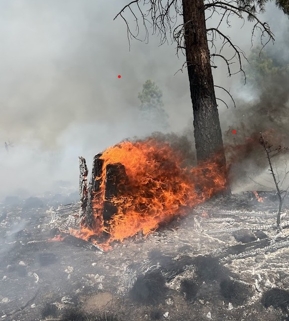

## Passionate about Cultivating Resilient Communities

I am a landscape-level thinker that prioritizes collaborative work putting research into action. I specialize in integrating fire research in forest management planning over large-extents. My work builds on my history using remote-sensing techniques, including satellite imagery and drone-based lidar (light detection and ranging) to model forest recovery (or lack of recovery) after large and high severity wildfire. Importantly, I have always prioritized collaborative decision making - recognizing the inherent disconnect between what is measured by satellites and what is observed and experienced on the ground.

::::: columns
::: {.column width="40%"}
My work aims to proactively manage forest for resilience - both for human communities and forest ecosystems. In my current role, as the TNC forest restoration project manager, I build resilience combining effective collaborative on-the-ground work, comprehensive documentation and monitoring, and clear, consistent communication. I believe that when everyone has seat at the table, and we understand what is on the table, we can make better decisions together.
:::

::: {.column width="60%"}

:::

## Contact Me

I am passionate about collaborative research and enthusiastic about science communication. Please reach out if you are interested in collaborations on landscape level fire resilience or systematic literature reviews

### My Details

Email: sarahsmith.tripp\@gmail.com Whatsapp: +1-503-990-5072
:::::